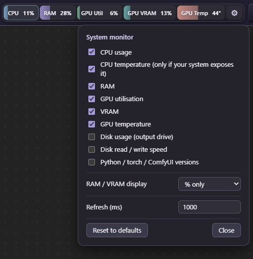

# ComfyUI SysBar

A system monitor that docks in the ComfyUI top bar, next to the Run / Manager buttons. Live CPU, RAM, GPU, VRAM and disk stats with pastel colour-coded meters, smooth animation and a settings panel to choose what you see.



## Features

- **Live meters** - CPU, RAM, GPU utilisation, VRAM and GPU temperature, each with a colour-coded fill bar.
- **Totals and usage** - RAM and VRAM show a percentage and used / total (for example `28%  9.1/32G`). Hover a meter for the full figures.
- **Optional extras** - disk usage of your output drive, disk read / write speed, and Python / torch / CUDA / ComfyUI versions.
- **Customisable** - click the gear to toggle each meter, switch RAM / VRAM between percent, amount or both, and set the refresh rate. Settings are saved in your browser.
- **Smooth animation** - bars glide and numbers count between readings. Respects your OS reduced-motion setting.
- **Load warning** - meters fade towards rose when they get close to full.
- **Multi-GPU** - each NVIDIA GPU gets its own meters.
- **Docks in the top bar** - re-docks itself if the ComfyUI frontend redraws the bar, and falls back to a floating bar if it can't find a spot.

## Installation

1. Go to your ComfyUI `custom_nodes` folder:
   ```
   cd ComfyUI/custom_nodes
   ```
2. Clone this repo:
   ```
   git clone https://github.com/Nognig6969/ComfyUI-SysBar.git
   ```
3. Install the requirements with the same Python that runs ComfyUI:
   ```
   .\python_embeded\python.exe -m pip install -r .\ComfyUI\custom_nodes\ComfyUI-SysBar\requirements.txt
   ```
4. Restart ComfyUI and hard-refresh the browser (Ctrl+F5).
5. Disable any other top-bar monitor (such as Crystools) so you don't get two bars.

## Usage

- The bar appears in the top bar to the left of the Run / Manager buttons.
- Click the gear at the end of the bar to open the settings panel.
- Tick or untick meters to show or hide them.
- **RAM / VRAM display** switches between percent only, amount only, or both.
- **Refresh** sets how often stats update, in milliseconds (minimum 250).
- **Reset to defaults** restores the original layout.

## Notes and limitations

- **NVIDIA only** for GPU stats (utilisation, VRAM, temperature). It uses `nvidia-ml-py` and falls back to `nvidia-smi` if that isn't installed. With no NVIDIA GPU the GPU meters simply don't appear.
- **CPU temperature** is only shown if your OS exposes it. Windows normally doesn't, so the meter stays hidden there.
- Disk usage is for the drive that holds your ComfyUI output folder. Disk read / write is system-wide.
- If the bar doesn't dock where you expect, it may be because your ComfyUI frontend version uses a different top-bar layout. Open an issue with the class name of the Run button's container and it can be fixed.

## Data storage

Nothing is stored on disk by this node. Settings live in your browser's local storage, and stats are read live from your system each time the bar refreshes.

## Credits

Inspired by the look of the Crystools resource monitor.

## License

MIT - see [LICENSE](LICENSE).
